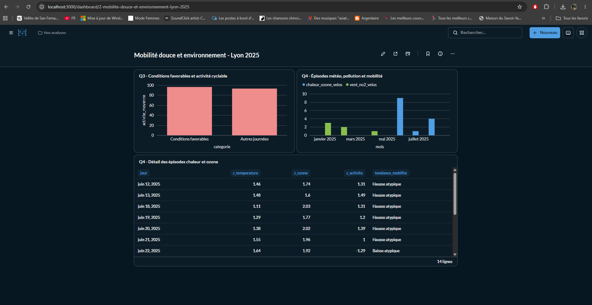

# Analyses métier — Météo, pollution et mobilité douce (2025)

**Projet :** [Data Lake IoT](https://github.com/LeoLChalot/datalake-iot)  
**Branche de développement :** `dev/Partie-Cleg`  
**Stack :** PostgreSQL 17, Docker, SQL, Metabase  
**Périmètre :** questions métier Q1–Q4 ; **Q1 multi-villes**, **Q2–Q4 : étude de cas Lyon, du 1er janvier au 24 août 2025**.

> **Statut au 22 octobre 2026 :** les scripts de construction Gold ont été exécutés avec succès sur la base locale `main_bd` et les analyses Q3/Q4 ont été visualisées dans Metabase. Le contenu de PostgreSQL et le dashboard interactif **ne sont pas** inclus dans ce dépôt Git : les scripts et la capture permettent d'en comprendre/reproduire le travail.



## 1. Questions métier et résultats

| Question | Périmètre | Indicateur principal | Résultat constaté |
|---|---|---|---|
| **Q1 — Météo et pollution** | 10 villes françaises | Corrélations de Pearson, par polluant et ville | À **Lyon**, température × ozone (O₃) : **r = +0,754** ; vent × NO₂ : **r = −0,580**. Température × O₃ positive dans les 10 villes (r de +0,520 à +0,798). |
| **Q2 — Météo et activité cyclable** | Lyon | Pearson entre météo et baisses de stock de vélos normalisées | Température : **r = +0,408** ; précipitations : **r = −0,262** ; vent : **r = −0,174**. |
| **Q3 — Conditions favorables à la mobilité douce** | Lyon | Moyenne des départs apparents / 100 station-heures ; Pearson point-bisérial | **17 jours favorables sur 210** évaluables ; **96,48** départs apparents / 100 station-heures, contre **93,28** les autres jours (**+3,4 %**) ; **r = +0,056** (association très faible). |
| **Q4 — Co-occurrences météo, pollution et mobilité** | Lyon | Scores Z, seuils ±1 écart-type ; épisodes à trois sources | **14** épisodes chaleur + O₃ + mobilité atypique (**9 hausses**, **5 baisses**) ; **6** épisodes vent faible + NO₂ + mobilité atypique (**1 hausse**, **5 baisses**). |

Ces corrélations **ne démontrent pas une causalité**. Les résultats ne tiennent pas lieu de tests de significativité (pas de p-value ou d'intervalle de confiance estimé ici).

### Couverture des données utilisées

- **NOAA / météo** : observations historiques jusqu'au **24 août 2025** dans les imports disponibles ; agrégation quotidienne par station.
- **OpenAQ / pollution** : observations de 2025 et 2026 ; agrégation quotidienne par localisation et polluant.
- **CityBikes / Vélo'v 2025** : **3 570 166** relevés, **433** stations, **365** jours calendaires et **8 734** instants horaires distincts, à Lyon. Les données sources couvrent toute l'année 2025.
- **Croisement Gold Lyon** : **236 jours** (du 1er janvier au 24 août 2025) sur lesquels météo et activité vélo sont disponibles ; **210** jours évaluables pour le critère combiné de Q3 (dépendant notamment des données d'ozone).

### Important : que mesure l'« activité cyclable » ?

La source CityBikes mesure le **stock de vélos disponibles** à chaque station à un instant donné. Le pipeline calcule les **baisses de stock entre observations consécutives séparées d'une heure** (par station), puis les rapporte à **100 station-heures valides**. Ce sont des **départs apparents**, pas le nombre réel et exhaustif de trajets : mouvements de rééquilibrage, emprunts/retours multiples entre relevés ou données manquantes peuvent influencer le proxy.

## 2. Fichiers de cette contribution

| Fichier | Description |
|---|---|
| [`00_verifications.sql`](00_verifications.sql) | Vérifie la couverture de `silver_velo_stations_2025`, les villes, stations, dates et valeurs incohérentes. |
| [`01_creation_gold_velos_2025.sql`](01_creation_gold_velos_2025.sql) | Produit et indexe six tables Gold persistantes dans `analytics`, à partir des données Silver et Gold préparatoires. |
| [`02_requetes_metabase_4_questions.sql`](02_requetes_metabase_4_questions.sql) | Requêtes d'indicateurs et de visualisations pour Q1, Q2, Q3 et Q4. **À exécuter une par une** dans Metabase. |
| [`03_guide_oral.md`](03_guide_oral.md) | Méthodes et trame de soutenance ; certains passages sont des modèles à actualiser avec les valeurs réelles récapitulées ici. |
| [`README.md`](README.md) | Ce guide pour les membres de l'équipe. |

## 3. Reproduire le travail en local

### Prérequis

- Docker opérationnel, avec le conteneur PostgreSQL nommé **`postgres-db`**.
- Base de données PostgreSQL **`main_bd`**, utilisateur **`myuser`** (adapter les identifiants si la configuration locale est différente).
- Tables préexistantes :
  - `public.silver_velo_stations_2025` (dump SQL CityBikes 2025, **non versionné ici**) ;
  - `analytics.meteo_daily` ;
  - `analytics.noaa_station_city_map` (associations station météo ↔ ville vérifiées) ;
  - `analytics.gold_meteo_pollution_daily` ;
  - `analytics.gold_correlations_meteo_pollution` (pour Q1).

**Ces dépendances ne sont pas toutes créées par les quatre fichiers de ce dossier.** Il faut restaurer/préparer les données NOAA et OpenAQ et leurs tables intermédiaires avant d'exécuter la construction Gold de Lyon. Les dumps SQL sources peuvent être volumineux : **ne pas les ajouter au dépôt Git par défaut**.

### Étape A — Vérifier la source CityBikes

Depuis **PowerShell**, à la racine du bon dépôt `datalake-iot/datalake-iot` :

```powershell
docker exec postgres-db psql -U myuser -d main_bd -tAc "SELECT to_regclass('public.silver_velo_stations_2025');"
```

Si cette commande ne retourne rien, la table est absente. Demander le dump CityBikes 2025 à l'équipe, l'extraire hors dépôt, puis depuis le dossier contenant `silver_citybikes_2025.sql` :

```powershell
cmd /c "docker exec -i postgres-db psql -v ON_ERROR_STOP=1 -U myuser -d main_bd < silver_citybikes_2025.sql"
```

**Ne pas restaurer le dump une seconde fois si la table existe déjà** : il contient un `CREATE TABLE` et un `COPY`.

### Étape B — Vérifier et reconstruire les tables Gold

Depuis le dossier `sql/` dans **PowerShell** :

```powershell
cmd /c "docker exec -i postgres-db psql -v ON_ERROR_STOP=1 -U myuser -d main_bd < 00_verifications.sql"
cmd /c "docker exec -i postgres-db psql -v ON_ERROR_STOP=1 -U myuser -d main_bd < 01_creation_gold_velos_2025.sql"
```

> **Attention :** `01_creation_gold_velos_2025.sql` exécute un `DROP TABLE IF EXISTS` puis recrée **ses six tables Gold** dans une transaction. Il ne supprime pas les tables Silver et n'efface pas les autres tables Gold, mais toute modification manuelle dans ces six tables serait perdue lors d'une relance.

Bilan attendu dans notre environnement de test :

| Table `analytics` | Lignes |
|---|---:|
| `gold_velo_lyon_hourly_2025` | 8 734 |
| `gold_velo_lyon_daily_2025` | 365 |
| `gold_lyon_croisement_2025` | 236 |
| `gold_lyon_correlations_2025` | 1 |
| `gold_lyon_conditions_mobilite_2025` | 236 |
| `gold_lyon_episodes_2025` | 236 |

Pour vérifier une fois les tables construites :

```powershell
docker exec postgres-db psql -U myuser -d main_bd -c "SELECT * FROM analytics.gold_lyon_correlations_2025;"
```

### Étape C — Visualiser dans Metabase

1. Ouvrir **`http://localhost:3000`** (l'adresse renvoie à **votre propre instance locale**, pas à celle de Cleg).
2. Choisir la connexion PostgreSQL **`DataLake IoT`** (nom d'affichage de la base `main_bd` dans l'instance utilisée pour ce projet).
3. Dans **+ Nouveau → Requête SQL**, copier **une seule requête** du fichier [`02_requetes_metabase_4_questions.sql`](02_requetes_metabase_4_questions.sql).
4. Exécuter, choisir une visualisation, puis enregistrer dans une collection.
5. Si les tables `analytics` sont invisibles, resynchroniser le schéma depuis l'administration de la base Metabase.

**Dashboard local réalisé :** « Mobilité douce et environnement – Lyon 2025 », avec un histogramme Q3, un graphique mensuel Q4 et le tableau des 14 épisodes chaleur–ozone–mobilité. Le dashboard interactif lui-même n'est pas transféré via Git ; une **capture d'écran** est incluse dans `docs/screenshots/`.

## 4. Lecture des questions 3 et 4 à l'oral

### Q3 — Conditions favorables

- Le classement « favorable » utilise des **seuils exploratoires et relatifs** à l'échantillon lyonnais : température entre les quartiles 25 % et 75 %, vent, pluie, O₃ et PM2.5 **au plus à leur médiane**.
- Sur **210 jours évaluables**, **17** respectent tous les critères, soit **8,1 %**.
- La différence entre moyennes est **+3,4 %** pour les jours favorables, mais le Pearson point-bisérial vaut **+0,056** : **pas d'association linéaire notable** entre ce classement et l'activité apparente.
- **Conclusion :** les conditions environnementales choisies ne suffisent pas, à elles seules, à prédire l'activité cyclable. Le faible effectif du groupe favorable et les variables non contrôlées limitent la portée de cette observation.

### Q4 — Épisodes conjoints

- Les **scores Z** expriment combien d'écarts-types chaque valeur se situe au-dessus ou en dessous de sa moyenne. Le script identifie « chaleur + ozone élevé » ou « vent faible + NO₂ élevé » à partir de seuils **Z ≥ +1**, puis retient **|Z activité| ≥ 1** pour la mobilité atypique.
- **14** journées « chaleur + ozone + mobilité atypique » : **9** hausses et **5** baisses apparentes ; **6** journées « vent faible + NO₂ + mobilité atypique » : **1** hausse et **5** baisses.
- Certaines journées de **juin 2025** présentent une hausse atypique de l'activité, alors que plusieurs journées d'**août 2025** présentent une baisse, malgré la présence d'un épisode chaleur–ozone.
- **Conclusion :** nous détectons des **co-occurrences d'anomalies**, pas une réaction uniforme de la mobilité ni une interaction causale prouvée.

## 5. Limites et suites possibles

- **Géographie :** Q1 compare 10 villes ; Q2–Q4 analysent seulement Lyon. La station NOAA utilisée (Lyon Bron) est un **proxy météorologique**, pas une mesure exacte à chaque station Vélo'v.
- **Fuseaux et unités :** CityBikes est horodaté en UTC ; les timestamps NOAA/OpenAQ sans fuseau ont été traités à la journée sous une hypothèse UTC **à valider**. Vérifier les unités transformées des mesures météo avant d'en tirer des seuils physiques.
- **Source mobilité :** vérifier la **provenance et l'authenticité historique** de l'export CityBikes 2025 ; les données pourraient être préparées ou simulées pour le TP. Ne pas les présenter comme historiques réels certifiés sans validation.
- **Analyse statistique :** saisonnalité, week-end/jour de semaine, vacances, géographie, météo retardée et rééquilibrage des vélos peuvent influencer les associations. Aucun ajustement causal ni test de significativité n'est effectué ici.
- **Pistes d'amélioration :** utiliser des données de trajets authentifiés, harmoniser précisément les zones géographiques et fuseaux, stratifier par saison et jour de semaine, puis ajouter tests d'incertitude et analyses multivariées.

---

**Contribution Cleg —** préparation de la couche Gold Lyon 2025, requêtes d'analyse et visualisation Metabase (Q3/Q4).  
Pour proposer des modifications : travailler sur une branche, ouvrir une Pull Request vers `dev/Partie-Cleg` ou coordonner l'intégration vers `main` avec l'équipe.
